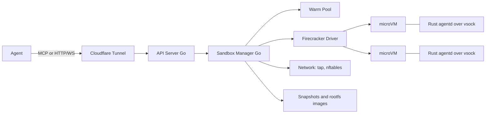

# Firecracker Agent Computers - Plan

Build a Go control plane plus a Rust in-VM guest agent that gives agents isolated Firecracker microVMs ("computers") in well under a second via snapshot/restore and a warm pool, exposed through an HTTP/WebSocket API and an MCP server. v1 is headless Linux: shell exec, file I/O, outbound network. Since November 2026, images may also have a virtual screen (desktop image, screenshots and computer-use input); see `docs/API.md#screen`.

Shared memory for all agents: innernet project `agent-comp` (see "Shared memory: innernet").

## Tasks

- [ ] `verify-host`: Finish host setup on ubuntu@comp-agents (KVM, x86_64, kernel 6.8, cgroups v2, nested virt, 4 vCPU, 15 GiB confirmed). Add `ubuntu` to the kvm group, install Firecracker and jailer, boot the quickstart microVM, and time cold boot plus snapshot restore as the baseline.
- [ ] `ingress-tunnel`: Install cloudflared on comp-agents as a systemd service with a named tunnel to `127.0.0.1:<acd-port>`. Verify WebSocket and streaming work end to end. Layer API key auth plus optional Cloudflare Access. Keep dev access via `ssh comp-agent`.
- [ ] `innernet-setup`: Create innernet project `agent-comp` (architecture, decisions, infra, conventions, roadmap), set the capture protocol (no secrets), mirror todos as innernet tasks, and write the first handoff. Add `AGENTS.md` pointing agents to it.
- [ ] `install-skills`: Install the curated Go, Rust, protobuf, MCP, sandbox, security and Actions skills at project level and commit them.
- [ ] `scaffold`: Scaffold the Go module and the Rust workspace for the guest agent, the directory layout, and lint/format configs (golangci-lint, gofumpt, clippy, rustfmt, cargo-deny, buf). Add a Makefile with lint/test/build/integration and remote deploy targets. Commit and push.
- [ ] `vmm-driver`: Implement the Driver interface and the Firecracker driver with jailer, CoW rootfs overlays and cgroup limits.
- [ ] `guest-agent`: Build the Rust in-VM agentd over vsock (static musl binary): streaming exec, file ops, post-restore fixups.
- [ ] `snapshots-pool`: Golden snapshot creation, the snapshot restore path, a warm pool with refiller, plus benchmarks.
- [ ] `networking`: Per-VM netns, tap and veth, IP allocator, nftables egress policy.
- [ ] `api-lifecycle`: Sandbox manager with state machine, TTL reaper, quotas, REST and WebSocket API with auth.
- [ ] `mcp-server`: MCP server wrapper exposing computer tools over streamable HTTP and stdio.
- [ ] `images-hardening`: Base rootfs image build pipeline, security hardening checklist, metrics and logging.
- [ ] `github-actions`: Final phase. GitHub Actions for lint, test, build, buf checks, a KVM integration job on a self-hosted runner on comp-agent, and release artifacts, all calling the Makefile targets.

## Context

- The workspace `agent-comp` started empty (one `init` commit). The local dev machine is macOS arm64, which has no KVM. Everything that boots VMs must run on the remote Linux host `ubuntu@comp-agents`.
- Decisions: Firecracker directly, Go control plane, Rust guest agent, v1 is headless shell, API is HTTP/WebSocket with an MCP wrapper.
- Host facts (verified on `ubuntu@comp-agents`):
  - Ubuntu 24.04.5, kernel 6.8.0-106-generic, x86_64, cgroups v2 (`cgroup2fs`).
  - 4 vCPUs (`nproc`; an earlier "8" was `grep -c` counting both the `flags` and `vmx flags` lines per CPU), 15 GiB RAM, no swap, 77 GB ext4 root with 74 GB free (no reflink).
  - `/dev/kvm` is present (`root:kvm`, mode 660), VT-x is exposed, and `systemd-detect-virt` reports `kvm`, so this is a KVM guest and Firecracker runs under nested virtualization.
  - `ubuntu` is not in the `kvm` group (groups: adm cdrom sudo dip lxd). Fix with `sudo usermod -aG kvm ubuntu` and re-login, or run `acd` as root and let jailer drop privileges.
  - Network: `eth0` 10.253.0.104/24 (private), `tailscale0` 100.83.69.54. No public IP. Outbound internet works.
- Consequences: modest density (rough budget of 50-100 idle 128-256 MB microVMs, bounded by 15 GiB RAM and 4 vCPUs), restore latency worse than bare metal because of nested EPT, and no reflink for rootfs copies.
- `comp-agents` is the development target only. Before production, everything is development. Production hardware comes later, most likely bare metal.

## Architecture

## Step 0: Finish host verification

Confirmed: KVM available, x86_64, kernel 6.8, cgroups v2, nested virt, 4 vCPU, 15 GiB RAM, ext4 root. Remaining on the VM:

- Add `ubuntu` to the `kvm` group and confirm `[ -r /dev/kvm ] && [ -w /dev/kvm ]`.
- Check that nested KVM is functional, not just present: `lsmod | grep kvm`, and `dmesg | grep -i kvm`. The Firecracker smoke test below is the real proof.
- Install the Firecracker release binary plus `jailer` (x86_64). Smoke test: boot a microVM with the official quickstart kernel and rootfs, and time the cold boot.
- Time a snapshot create and restore on this host. This gives our real baseline for the "snap" target under nested virt, before we write any code.
- Optional: `lsblk` to see whether a second disk exists for a dedicated XFS volume (not required, see Step 2).
- Kata check (`kata-runtime check`) is optional and only informs a later driver option.

## Step 0.5: Access and ingress (host is behind Tailscale, no public IP)

Two separate paths:

- **Dev access (us to the host):** SSH works over the tailnet with `ssh comp-agent` (`~/.ssh/config` host entry: `Hostname comp-agents`, `User ubuntu`, key `~/.ssh/keys/comp-agent.pem`). All builds, deploys and tests on the box go through this alias. The alias is `comp-agent` (singular), the tailnet name is `comp-agents`.
- **Agent access (agents to the API):** agents are on the public internet, so `acd` stays bound to `127.0.0.1` and a **Cloudflare Tunnel** (`cloudflared`, outbound-only, so no inbound ports or public IP are needed) publishes it, for example `https://computers.<your-domain>`.
  - Install `cloudflared` on the host and run it as a systemd service with a named tunnel. Route the hostname to `http://127.0.0.1:<acd-port>`.
  - Cloudflare Tunnel supports WebSockets and streaming responses, which covers our streaming exec and the MCP streamable HTTP transport. We must disable response buffering and set sensible idle timeouts, and the MCP server must send keepalives.
  - Auth is layered: our own bearer API keys on every request (required), plus optional Cloudflare Access service tokens in front for defense in depth. Rate limit at the Cloudflare edge and again in `acd`.
  - The tunnel carries only the control API. Sandbox traffic never goes through it: the VMs reach the host only over vsock.
- **Sandbox egress must not touch the tailnet or the host LAN.** The egress deny list must include the Tailscale range `100.64.0.0/10` (and `fd7a:115c:a1e0::/48`), the host's own subnet (`10.253.0.0/24`), the cloud metadata IP `169.254.169.254`, and all RFC1918 ranges. Otherwise an agent inside a sandbox could reach other tailnet machines through the host's NAT. Also choose the sandbox address pool so it does not collide with `10.253.0.0/24` or `100.64.0.0/10`, for example a configurable default of `10.200.0.0/16`.

## Shared memory: innernet

innernet (MCP namespace `user-innernet`) is the shared memory for every agent that works on this repo (Cursor, Claude, Codex, subagents). They all read and write the same project there.

- **Project:** slug `agent-comp`, type `code`. Its dimensions:
  - `plan`: this document.
  - `architecture`: components, Go control plane plus Rust `agentd` over vsock, the diagram.
  - `decisions`: the decision log, each entry with its date and who decided.
  - `infra`: `comp-agents` host facts, nested virt, `ssh comp-agent`, Tailscale, the egress deny list, and which numbers are dev-only.
  - `conventions`: the Go, Rust, protobuf and Git practices, and the installed skills.
  - `roadmap`: steps and milestones with their status.
- **Capture protocol:** keep architecture and design decisions with their rationale, host and infra facts, benchmark results (tagged dev or prod), gotchas and failed approaches, and milestone status. Never store secrets: no API keys, Cloudflare tunnel tokens, SSH private keys or `.env` contents. Paths and names are fine.
- **Tasks:** mirror the plan tasks with `innernet_task_create`. Saves advance them automatically, and they're marked done as each stage ships.
- **Per-stage loop**, which every agent follows:
  1. Start of session: `innernet_handoff_read`, then `innernet_context` with the current ask.
  2. During work: `innernet_capture` for gotchas and decisions as they happen.
  3. End of stage, after the push to GitHub: `innernet_save_context` for changed dimensions (write the present, with a dated `## history` line for anything superseded). Then `innernet_handoff_write` with where we left off, what's next, the commit SHA, and open issues.
- **Repo pointer:** a short `AGENTS.md` in the repo tells any agent to load innernet project `agent-comp` first and follow the loop above. The repo holds code and docs. innernet holds decisions, state and handoffs.

## Engineering practices, skills and Git workflow

### Skills to install (project-level, before Step 1)

These are curated from `npx skills find`, favoring publishers with large install counts or official maintainers.

- **Go** (samber/cc-skills-golang, about 40K+ installs each): `golang-code-style`, `golang-error-handling`, `golang-concurrency`, `golang-context`, `golang-testing`, `golang-performance`, `golang-security`, `golang-observability`, `golang-design-patterns`.
- **Rust:** `apollographql/skills@rust-best-practices` (22K), `wshobson/agents@rust-async-patterns` (22K, tokio), `affaan-m/ecc@rust-testing` (13K).
- **Protocol (Go and Rust, shared):** `bufbuild/claude-plugins@protobuf` (official Buf).
- **MCP:** `github/awesome-copilot@go-mcp-server-generator` (9K).
- **Agent sandboxes (design reference for the API):** `rivet-dev/skills@sandbox-agent` (10K).
- **Security:** `openai/skills@security-threat-model` (threat-model the sandbox boundary), `addyosmani/agent-skills@security-and-hardening`.
- **CI, for the later Actions phase:** `github/awesome-copilot@github-actions-hardening`, `wshobson/agents@github-actions-templates`.
- **Networking:** no credible skill exists for tap, netns or nftables (best hits have under 500 installs). We rely on Firecracker's official network docs and the `vishvananda/netlink` and `google/nftables` library docs instead.
- **Install command:** `npx skills add <owner/repo@skill> -y`, into the project and committed, so CI and other agents see them too.

### Go practices (control plane)

- Go 1.24+, standard module layout (`cmd/`, `internal/`), with `gofumpt` and `goimports`.
- Lint with `golangci-lint` (`errcheck`, `govet`, `staticcheck`, `gosec`, `revive`, `errorlint`, `contextcheck`, `bodyclose`, `noctx`) and a shared `.golangci.yml`.
- `context.Context` is the first parameter on every blocking path. Wrap errors with `%w` and sentinel or typed errors. Use `log/slog` for structured logging and no global state beyond `main`.
- Tests: table-driven, `go test -race`. Integration tests that need KVM sit behind a `//go:build integration` tag and run on `comp-agent`. Run `govulncheck`.

### Rust practices (guest agent)

- Pinned `rust-toolchain.toml` (stable, with musl target), `rustfmt.toml`, and `cargo clippy -- -D warnings` (plus selected `clippy::pedantic`).
- `thiserror` for library errors and `anyhow` only at the binary edge. No `unwrap` or `expect` outside tests.
- `#![forbid(unsafe_code)]` except in a small, documented module if vsock or PID-1 syscalls require it.
- `cargo-deny` (licenses and advisories) and `cargo-audit`. Release profile: `lto = "thin"`, `codegen-units = 1`, `panic = "abort"`, `strip = true` for a small binary.

### Shared

- Protobuf schemas in `proto/`, managed with `buf` (`buf lint`, `buf breaking`), generating code for both Go and Rust.
- Every check runs through one `Makefile` (`make lint`, `make test`, `make build`, `make integration`), so the later GitHub Actions workflows just call the same targets.
- `.editorconfig`, `.gitignore`, and a `README` with dev setup (`ssh comp-agent`, how to deploy and run).

### Git workflow

- Remote: [mondeep31/agent-comp](https://github.com/mondeep31/agent-comp).
- After each stage, if `make lint` and `make test` pass: commit with Conventional Commits (`feat(vmm): ...`, `chore: ...`) and push to `main`. Use one commit or a few small commits per stage, never a dump.
- Tag milestones (`v0.1.0-m1`, ...) when a milestone is reached.
- GitHub Actions (lint, test, build, a KVM integration job on a self-hosted runner on `comp-agent`, and release artifacts) come after everything else, as the final phase.

## Step 1: Repo scaffold

- Go module with this layout: `cmd/acd` (daemon), `cmd/acctl` (CLI), `internal/{vmm,sandbox,pool,network,guest,api,mcp,images}`, `images/` (rootfs build scripts), `docs/`.
- Rust workspace in `guest/agentd` for the in-VM agent, built for `x86_64-unknown-linux-musl` as a static binary. A shared protocol definition (protobuf or a small JSON/CBOR schema) lives in `proto/` and generates both the Go client (`internal/guest`) and the Rust server.
- A `Makefile` with a linux cross-compile target for the Go daemon, a musl build for `agentd`, and a remote deploy/test target (rsync or ssh to `comp-agent`).

## Step 2: Firecracker driver (`internal/vmm`)

- Define a `Driver` interface (`Create`, `Start`, `Pause`, `Snapshot`, `Restore`, `Stop`) so Kata or Cloud Hypervisor can be added later without touching callers.
- Implement it with `firecracker-go-sdk`.
- Run every VM under `jailer`: chroot, a seccomp filter, per-VM uid and gid, cgroup limits for CPU and memory, and a netns per VM.
- Use a minimal guest kernel (build a trimmed config, or start from Firecracker's recommended guest config) and a per-image rootfs.
- Rootfs strategy, because the host is plain ext4 with no reflink: attach the base image as a shared read-only drive, plus a small sparse per-VM writable drive. `agentd` (as init) mounts an overlayfs of the two. This needs no host copy-on-write support, shares the base in the host page cache across all VMs, and keeps per-VM disk cost proportional to what the agent writes. Reflink on XFS or dm-thin remain optional later optimizations.

## Step 3: Speed ("computers in a snap")

- **Golden snapshots:** boot a base image once, let the guest agent come up, then take a memory and state snapshot. Every new sandbox is a snapshot restore. The target is about 100-200 ms to a ready shell on bare metal. Under nested virt, plan for a looser first target (under about 400 ms) until we measure it in Step 0, and revisit.
- **Memory sharing for density:** restore with Firecracker's file-backed memory (`MAP_PRIVATE` mmap of the snapshot file). All VMs from one golden snapshot then share clean pages through the host page cache, and only dirtied pages cost RAM. This is the main lever for fitting many VMs in 15 GiB. Keep the golden memory file on fast storage and pre-warm it into the page cache. UFFD-based restore is a later option.
- **Small guests:** default to 1 vCPU and 128-256 MB per sandbox. With 4 host vCPUs, set a sane overcommit limit and per-VM CPU shares.
- **Warm pool:** keep N pre-restored, paused VMs per image, with a background refiller. Allocation then costs a few ms: take a VM from the pool, then inject identity, network and secrets.
- **Post-restore fixups:** guest agent re-seeds RNG, resyncs the clock and sets hostname and network.
- **Fast path for VM-to-host comms:** vsock for control, with no SSH and no network round trip.
- Benchmarks in-repo: p50/p95/p99 for create-to-first-command, plus density (VMs per host). Every benchmark is tagged with host type (dev nested-virt vs prod).

## Step 4: Guest agent (`guest/agentd`, Rust)

- Static musl Rust binary baked into the rootfs, started as init or PID 1 (reaps zombies, mounts `/proc`, `/sys`, `/dev`, sets up the vsock listener).
- Tokio-based, with a small dependency footprint to keep the binary and resident memory small, since it is in every VM and every snapshot.
- Serves over vsock: `exec` (streaming stdout and stderr, stdin, exit code, timeout, process-group kill), file read/write/list/stat, upload and download, and environment and cwd control.
- Framing: length-prefixed protobuf or gRPC over vsock, streaming-friendly. `tonic` is fine, but check its size cost against a hand-rolled framed protocol.
- Post-restore hook: a control message from the host triggers RNG reseed, clock sync, hostname and network config.

## Step 5: Networking (`internal/network`)

- A tap device per VM in its own netns, with a veth pair to the host bridge.
- NAT for outbound traffic. Default egress policy is deny-internal: block RFC1918, the Tailscale CGNAT range `100.64.0.0/10`, the host subnet, and the cloud metadata IP `169.254.169.254` (see Step 0.5). Per-sandbox allowlist is configurable via nftables.
- A /30 or /31 IP allocator from a configurable pool (default `10.200.0.0/16`), with cleanup on teardown.

## Step 6: Sandbox lifecycle and API (`internal/sandbox`, `internal/api`)

- States: `creating -> running -> paused -> stopped -> deleted`, plus a TTL and idle timeout reaper.
- Per-sandbox resource limits (vCPU, memory, disk, pids), and quotas per API key.
- REST: `POST /sandboxes`, `GET/DELETE /sandboxes/{id}`, `POST /sandboxes/{id}/exec`, `GET/PUT /sandboxes/{id}/files`, `POST /sandboxes/{id}/snapshot` (to fork or resume later).
- WebSocket: interactive and streaming exec.
- Auth: bearer API keys, and agent identity attached to each sandbox.

## Step 7: MCP server (`internal/mcp`)

- A thin wrapper over the same service layer. Tools: `create_computer`, `run_command`, `read_file`, `write_file`, `list_files`, `snapshot_computer`, `destroy_computer`.
- Transports: streamable HTTP, and stdio for local use.

## Step 8: Images and hardening

- Base image build pipeline (Debian/Ubuntu minimal plus python, node, git, build-essential). Images are versioned, and each image has its own golden snapshot.
- Security checklist: jailer plus seccomp, no shared writable state between VMs, disable memory ballooning and KSM side channels where it matters (document the tradeoff), per-VM rate limiters on disk and network I/O, and a clean teardown that zeroes and discards disk and memory.
- Observability: Prometheus metrics, structured logs, and per-sandbox lifecycle events.

## Milestones

1. Host verified and the Firecracker quickstart boots.
2. `acd` can create a VM, exec a command through the Rust `agentd`, and destroy it (cold boot).
3. Snapshot restore with golden images gives sub-250 ms create.
4. Warm pool gives single-digit ms allocation.
5. HTTP/WS API and the MCP server work end to end with a real agent.
6. Networking policy, quotas and hardening.
7. GitHub Actions CI and release pipeline.

## Design rules (dev now, prod later)

- Keep everything host-agnostic and configurable: paths, CIDRs, pool sizes and limits in one config file, with no hardcoded host assumptions.
- Keep the `Driver` and storage layers pluggable, so reflink, XFS or dm-thin can be swapped in on prod hosts.
- Tag every benchmark with host type so dev numbers are not mistaken for prod numbers.
- Keep the sandbox manager free of single-host assumptions so a multi-host scheduler can sit on top later.

## Open items

- Which provider or hypervisor hosts the dev VM, and whether a bare-metal host is an option later for production density and latency.
- A Cloudflare account with a domain (or a free `trycloudflare.com` quick tunnel for early testing only, since its URL changes each run), and permission to install `cloudflared` on the host.
- Expected scale: sandboxes per host, and whether a multi-host scheduler is needed later (out of scope for v1).
- Protocol choice for Go and Rust: protobuf/gRPC versus a lighter custom framing.
